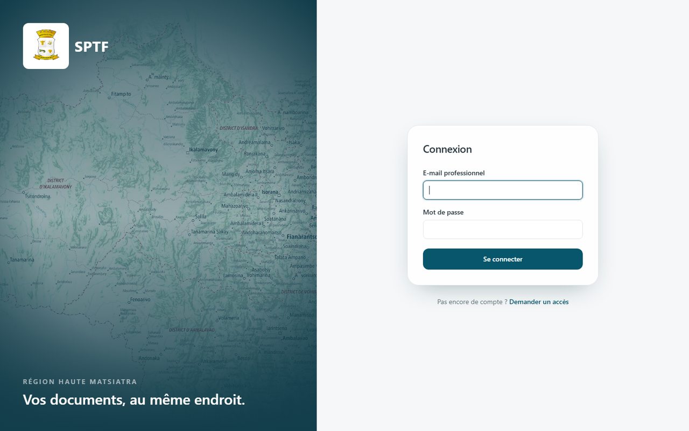
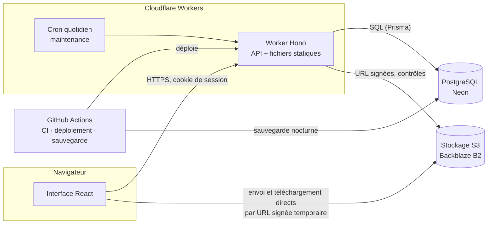
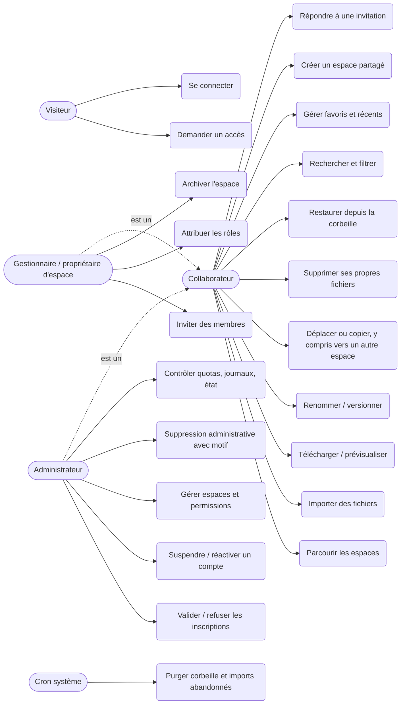
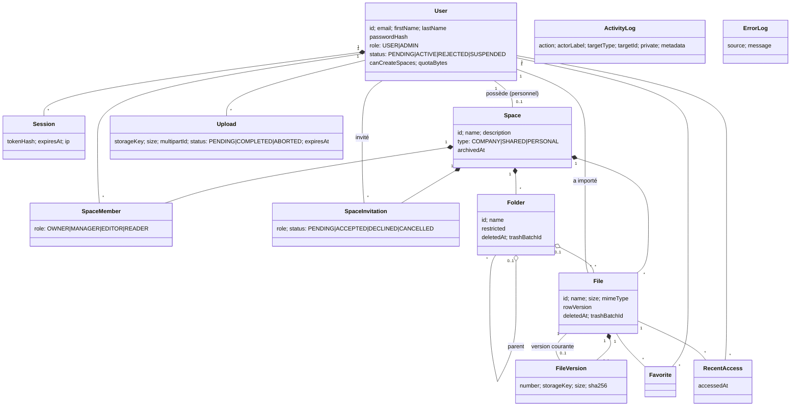
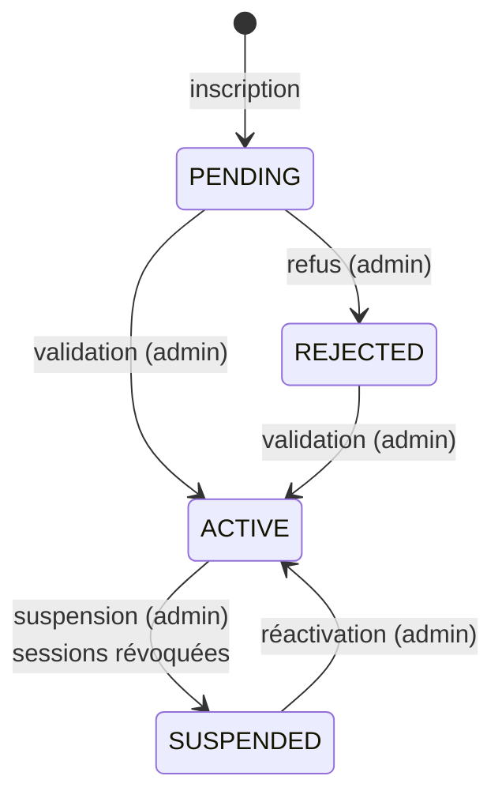
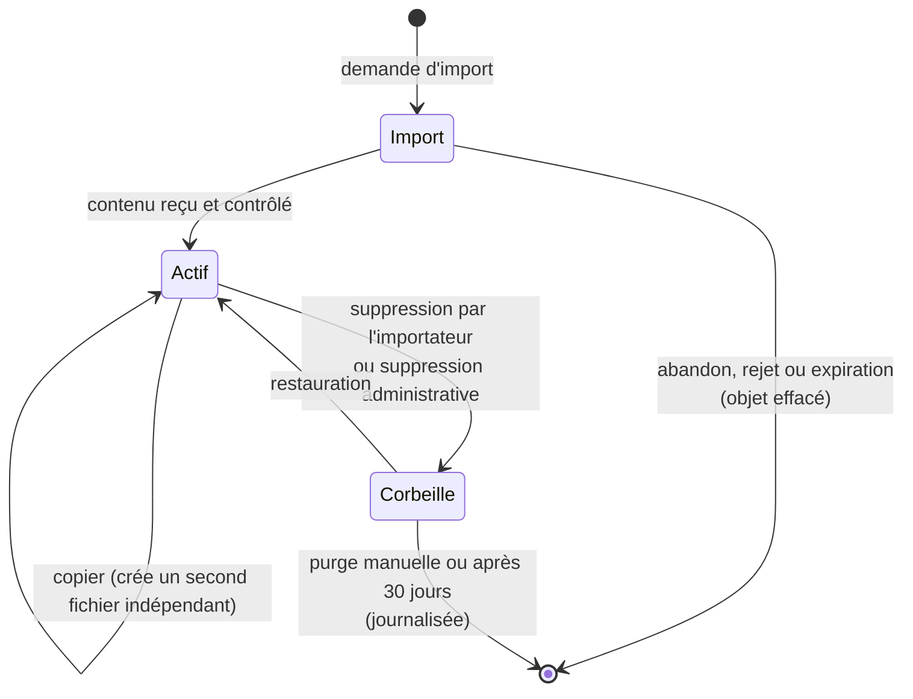
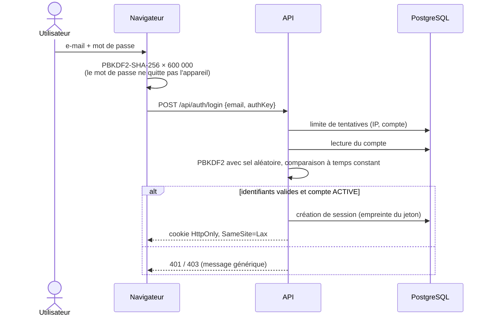
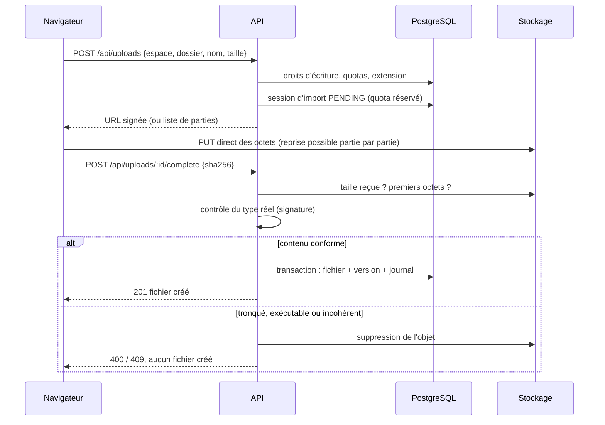
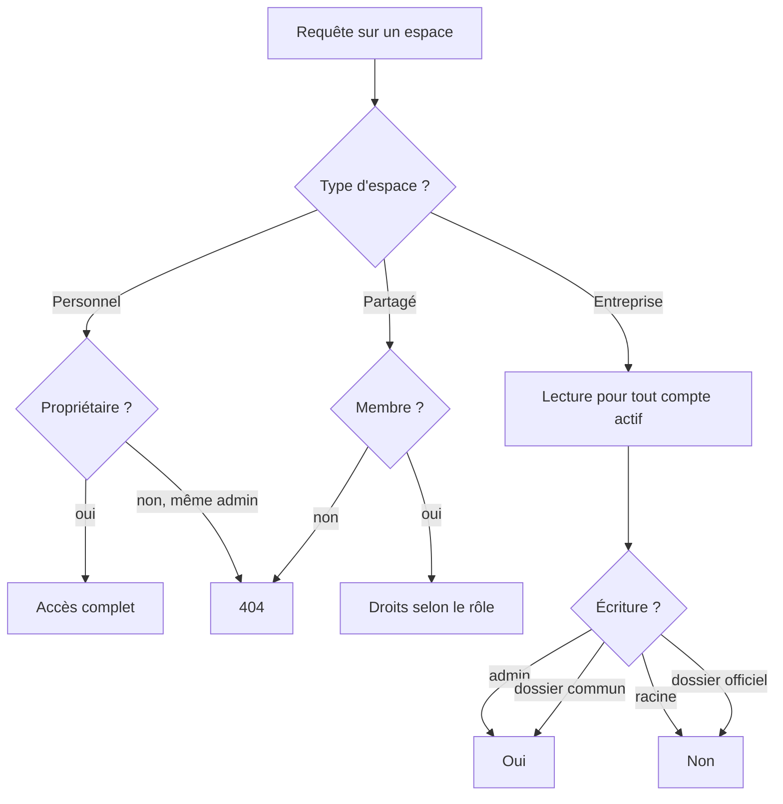

# SPTF — Plateforme de centralisation et de partage de fichiers

Application web d'entreprise : un espace commun, des espaces partagés sur invitation et un espace
personnel privé pour chaque collaborateur. Conçue pour tourner **12 mois sur des offres gratuites**,
puis migrer vers un serveur propriétaire local sans réécriture.



> **État du projet** — développement terminé et testé (108 tests automatisés). L'application
> n'est pas encore hébergée : la mise en ligne est prévue sur un serveur interne de l'entreprise
> (voir [docs/DEPLOIEMENT.md](docs/DEPLOIEMENT.md), section 10). Elle se lance en local en une
> commande, sans aucun service à installer — voir ci-dessous.

- [1. Lancer en local](#1-lancer-en-local)
- [2. Stack et outils](#2-stack-et-outils)
- [3. Architecture](#3-architecture)
- [4. Conception UML](#4-conception-uml)
- [5. Règles métier](#5-règles-métier)
- [6. Sécurité](#6-sécurité)
- [7. Fiabilité](#7-fiabilité)
- [8. Tests](#8-tests)
- [9. Infrastructure gratuite](#9-infrastructure-gratuite)
- [10. Structure du dépôt](#10-structure-du-dépôt)
- [11. Commandes](#11-commandes)
- [12. Guides d'exploitation](#12-guides-dexploitation)
- [13. Limites connues](#13-limites-connues)

---

## 1. Lancer en local

Seul prérequis : **Node.js 22 ou plus**. Aucune base ni service à installer : PostgreSQL est
embarqué (paquet npm) et le stockage de fichiers est émulé sur le disque.

### Lancement automatique (recommandé)

**Windows : double-cliquez sur `lancer.bat`.** Ou, dans un terminal :

```bash
npm install     # première fois uniquement
npm run local
```

Sans aucune autre manipulation, cette commande démarre la base et le stockage, applique les
migrations, crée un compte administrateur de test, compile l'interface si elle a changé, lance
l'application et ouvre **http://localhost:8787** dans le navigateur.

Les identifiants de l'administrateur (mot de passe aléatoire) sont affichés au premier lancement
et enregistrés dans `apps/api/.local/identifiants-admin.txt`. Arrêt : `Ctrl+C`.

### Lancement manuel (développement, avec rechargement à chaud)

```bash
# 1. Dépendances et configuration (une seule fois)
npm install
cp .env.example .env            # Windows PowerShell : Copy-Item .env.example .env

# 2. Terminal A — base PostgreSQL + stockage local (laisser tourner)
npm run dev:services

# 3. Terminal B — schéma de la base puis premier administrateur (une seule fois)
npm run db:deploy
npm run create-admin            # demande e-mail, prénom, nom, mot de passe (12 caractères min.)

# 4. Terminal B — API sur http://localhost:8787
npm run dev:api

# 5. Terminal C — interface sur http://localhost:5173
npm run dev:web
```

Ouvrez **http://localhost:5173** et connectez-vous avec le compte administrateur.

Parcours de test conseillé :

1. Dans une fenêtre privée, **Demander un accès** : inscrivez un second compte.
2. **Administration → Inscriptions** : validez-le.
3. Importez des fichiers (bouton ou glisser-déposer) : PDF, Word, Excel, image. Cliquez dessus pour l'aperçu.
4. Testez renommage, versions, **Copier vers…** et **Déplacer** d'un espace à l'autre, corbeille.
5. **Espaces partagés** : créez un espace, invitez l'autre compte, vérifiez les rôles.

Variante « comme en production » (un seul serveur sert l'API et l'interface compilée) :

```bash
npm run build
npm run start -w apps/api       # http://localhost:8787
```

Les données locales vivent dans `apps/api/.local/` : supprimez ce dossier pour repartir de zéro.

---

## 2. Stack et outils

### Frontend — `apps/web`

| Outil | Rôle |
|---|---|
| React 19 + TypeScript | Interface |
| Vite 7 | Serveur de développement et compilation |
| Tailwind CSS 4 | Styles (couleurs SPTF déclarées dans `src/index.css`) |
| shadcn/ui (approche) + Radix UI | Composants accessibles : dialogues, menus, menus contextuels (`src/components/ui.tsx`) |
| Lucide React | Icônes |
| React Router 7 | Navigation |
| TanStack Query 5 | Données serveur : cache, nouvelles tentatives avec backoff |
| React Hook Form + Zod 4 | Formulaires et validation |
| hash-wasm | Empreinte SHA-256 des fichiers, calculée par tranches |
| docx-preview, read-excel-file, JSZip | Aperçu des documents Word, Excel et PowerPoint dans le navigateur, chargés à la demande |
| Sonner | Notifications discrètes |

### Backend — `apps/api`

| Outil | Rôle |
|---|---|
| Node.js 22 + TypeScript | Langage et exécution |
| Hono 4 | Serveur HTTP. Le même code tourne sous Node.js **et** Cloudflare Workers |
| Prisma 7 | ORM, migrations versionnées (`prisma/migrations`) |
| PostgreSQL | Base de données (Neon en production, embarqué en local) |
| `@prisma/adapter-pg` / `@prisma/adapter-neon` | Connexion sous Node.js / sous Workers |
| aws4fetch | Signature S3 (URL signées, envoi en plusieurs parties) |
| Zod 4 | Validation de toutes les entrées |
| WebCrypto | Hachage des mots de passe et des jetons, identique sur les deux plateformes |

Express n'a pas été retenu : il ne tourne pas sur Workers, seul hébergement gratuit sans mise en
veille. Hono offre la même simplicité et reste portable.

### Outils de développement et d'exploitation

| Outil | Rôle |
|---|---|
| Vitest | Tests automatisés |
| embedded-postgres | Vrai PostgreSQL pour le développement et les tests, sans installation |
| `scripts/local-s3.ts` | Émulateur S3 local (développement et tests uniquement) |
| Wrangler | Déploiement Cloudflare Workers |
| esbuild / tsx | Compilation et exécution TypeScript |
| GitHub Actions | CI, déploiement, sauvegarde nocturne, contrôle de disponibilité |

---

## 3. Architecture



Trois choix structurants :

1. **Une seule origine.** Le Worker sert l'interface et l'API : pas de CORS, cookie de session
   `SameSite`, en-têtes de sécurité sur toutes les réponses.
2. **Les fichiers ne traversent jamais l'API.** Le navigateur envoie et reçoit les octets
   directement auprès du stockage grâce à des URL signées de courte durée. L'API ne manipule que
   des métadonnées : aucune limite de mémoire ni de taille de requête à craindre.
3. **Aucun code métier lié à un fournisseur.** Deux points d'entrée (`src/node.ts`,
   `src/worker.ts`) branchent la même application (`src/app.ts`) ; le stockage passe par
   l'interface `StorageAdapter`. Changer d'hébergeur revient à changer des variables
   d'environnement.

---

## 4. Conception UML

### 4.1 Cas d'utilisation



### 4.2 Diagramme de classes (modèle de données)

Source de vérité : `apps/api/prisma/schema.prisma`.



### 4.3 États d'un compte



### 4.4 États d'un fichier



### 4.5 Séquence — connexion



### 4.6 Séquence — import d'un fichier



### 4.7 Décision d'accès



---

## 5. Règles métier

| Espace | Lecture | Écriture |
|---|---|---|
| **Entreprise** | Tous les comptes actifs | Administrateurs partout. Collaborateurs dans tous les dossiers, sauf les dossiers « officiels » et la racine, réservés aux administrateurs |
| **Partagé** | Membres | Éditeur, gestionnaire, propriétaire |
| **Personnel** | Propriétaire seul | Propriétaire seul. Invisible des autres **et de l'administrateur** (seule la taille occupée lui est visible) |

Rôles d'un espace partagé : **lecteur** (consulter, télécharger) < **éditeur** (importer,
renommer, déplacer, versionner) < **gestionnaire** (inviter, gérer lecteurs et éditeurs) <
**propriétaire** (gérer les gestionnaires, archiver).

**Suppression.** Seul l'utilisateur qui a importé un fichier peut le supprimer, le restaurer ou le
purger. Les autres membres, propriétaire de l'espace compris, peuvent le modifier mais pas le
supprimer. L'administrateur dispose d'une suppression exceptionnelle : motif obligatoire, opération
consignée au journal. Un dossier ne peut être supprimé que par son créateur, et seulement s'il ne
contient aucun fichier importé par quelqu'un d'autre. Toute suppression passe par la corbeille
(30 jours par défaut). Ces règles sont appliquées par l'API (`src/lib/access.ts`), l'interface ne
fait que les refléter.

**Déplacer et copier.** Un fichier ou un dossier peut être copié vers n'importe quel espace où l'on a
le droit d'écrire, dès lors qu'on peut le lire : la copie est un nouveau fichier, dont l'auteur de
la copie devient l'importateur. Déplacer à l'intérieur d'un espace demande le droit d'écriture.
Déplacer vers un **autre** espace fait sortir l'élément de son espace d'origine : comme pour une
suppression, seul son importateur peut le faire (pour un dossier : son créateur, et seulement s'il
ne contient que ses propres fichiers).

**Aperçu.** Images, PDF, vidéo, audio, texte, Word (.docx) et Excel (.xlsx) s'affichent dans
l'application sans téléchargement. PowerPoint (.pptx) et OpenDocument (.odt) : aperçu du texte.

**Archivage.** Un espace partagé n'est jamais détruit par son propriétaire : il est archivé. Seul
un administrateur peut le restaurer ou le purger (motif et saisie du nom exigés).

---

## 6. Sécurité

| Sujet | Mise en œuvre |
|---|---|
| Mots de passe | PBKDF2-SHA-256 × 600 000 dans le navigateur, puis PBKDF2 salé côté serveur. Le serveur ne voit jamais le mot de passe en clair |
| Sessions | Jeton aléatoire de 256 bits en cookie `HttpOnly`, `Secure`, `SameSite=Lax`. Seule son empreinte est en base. Révocation immédiate à la suspension ou au changement de mot de passe |
| CSRF | Origine vérifiée et en-tête dédié exigé sur toute requête modifiante |
| XSS | Échappement React, politique CSP stricte, fichiers servis depuis une autre origine, HTML et SVG jamais affichés en ligne |
| Injections | Requêtes paramétrées (Prisma), entrées validées par Zod |
| Fichiers | Extensions exécutables refusées, type réel contrôlé sur les premiers octets, taille vérifiée, clés de stockage opaques |
| Permissions | Vérifiées sur chaque route. Une ressource interdite répond 404, comme une ressource inexistante |
| Limitation de débit | Persistée en base pour connexion et inscription, en mémoire pour le reste |
| Secrets | Uniquement côté serveur. Le navigateur ne reçoit que des URL signées valables 5 minutes |
| Journal | Connexions, échecs, imports, suppressions, actions d'administration. Consultable dans Administration → Journaux |
| Premier administrateur | Créé hors ligne par `npm run create-admin`. Aucune route HTTP ne le permet |

---

## 7. Fiabilité

- **Transferts interrompus.** Un fichier n'apparaît qu'une fois reçu en entier et contrôlé. Les
  gros fichiers partent en parties de 8 Mo : après une coupure, seules les parties manquantes sont
  renvoyées. Les imports abandonnés sont effacés par la maintenance.
- **Base en veille.** Neon suspend la base après 5 minutes d'inactivité : les erreurs de connexion
  sont rejouées avec backoff.
- **Modifications concurrentes.** Verrou optimiste (`rowVersion`) sur les fichiers, gardes d'état
  sur les invitations, validations de compte et finalisations d'import.
- **Opérations critiques en transaction**, journal compris.
- **Suppression définitive.** Lignes retirées en base d'abord, objets ensuite : une panne laisse au
  pire un objet orphelin signalé, jamais une ligne pointant vers un document disparu.
- **Quotas.** Capacité totale, quota personnel et taille maximale contrôlés avant chaque import.
  Alertes à 75 % et 90 % dans Administration → État.
- **Surveillance.** `GET /health` (base) et `GET /health?deep=1` (base + stockage).
- **Interface.** Error boundary par page, erreurs remontées au serveur, nouvelles tentatives
  automatiques sur les pannes passagères.

---

## 8. Tests

```bash
npm test
```

| Suite | Contenu |
|---|---|
| `apps/api/test/auth.test.ts` | Inscription, validation, connexion, CSRF, limitation de débit, sessions, suspension, dernier administrateur |
| `apps/api/test/files.test.ts` | Import, téléchargement, aperçu, contrôle de contenu, quotas, transferts interrompus, dossiers, versions, recherche, corbeille |
| `apps/api/test/multipart.test.ts` | Gros fichiers, reprise après coupure, parties manquantes, annulation, imports simultanés |
| `apps/api/test/spaces.test.ts` | Invitations, rôles, règle de suppression, confidentialité de l'espace personnel, espace entreprise, suppression administrative, archivage |
| `apps/api/test/transfer.test.ts` | Copie et déplacement entre espaces, droits, quotas, dossiers entiers |
| `apps/api/test/admin.test.ts` | Routes d'administration, quotas, journaux, santé, maintenance, en-têtes de sécurité |
| `apps/api/test/backup.test.ts` | Sauvegarde, vérification, restauration vers une autre base et un autre stockage, détection d'altération |
| `apps/web/src/lib/password.test.ts` | Cohérence du hachage navigateur / serveur, mots de passe faibles |

Les tests de l'API tournent contre un vrai PostgreSQL et de vrais transferts HTTP vers l'émulateur
S3. Le premier lancement télécharge PostgreSQL (une fois).

---

## 9. Infrastructure gratuite

Conditions relevées en novembre 2026 sur les pages officielles des fournisseurs. **À revérifier
avant l'ouverture des comptes** : ces offres évoluent.

| Brique | Fournisseur | Quotas gratuits | Risque principal | Remplacement |
|---|---|---|---|---|
| Interface + API | Cloudflare Workers | 100 000 requêtes/jour, 10 ms CPU par requête, 5 crons, bundle 3 Mo | Budget CPU serré | Même code en Node.js sur tout hébergeur ou VPS |
| Base | Neon Free | 1 Go, 100 CU-h/mois, 5 Go de transfert/mois, veille après 5 min | Base suspendue jusqu'au mois suivant si un quota est dépassé | Tout PostgreSQL |
| Fichiers | Backblaze B2 | 10 Go, 1 Go de téléchargement/jour, 2 500 transactions de lecture/jour | Plafond atteint : erreurs jusqu'au lendemain, pas de facture | Cloudflare R2, tout stockage S3 |
| CI, sauvegarde, surveillance | GitHub Actions | 2 000 min/mois (dépôt privé) | Workflows planifiés désactivés après 60 jours sans activité | Planificateur d'un poste de l'entreprise |

Solutions écartées :

- **Neon Object Storage** (5 Go) : ses téléchargements consomment les mêmes 5 Go de transfert
  mensuel que la base, dont l'épuisement suspend PostgreSQL.
- **Cloudflare R2** en stockage principal : tout dépassement est facturé.
- **Render Free** : mise en veille après 15 minutes, réveil d'une minute, et la documentation
  indique de ne pas l'utiliser en production.

---

## 10. Structure du dépôt

```
apps/
  api/
    prisma/schema.prisma        modèle de données
    prisma/migrations/          migrations SQL versionnées
    src/app.ts                  application HTTP (commune aux deux plateformes)
    src/node.ts                 entrée Node.js
    src/worker.ts               entrée Cloudflare Workers
    src/config.ts               configuration par variables d'environnement
    src/lib/access.ts           toutes les règles de permission et de quota
    src/lib/auth.ts             sessions, CSRF, limitation de débit
    src/lib/storage.ts          adaptateur de stockage S3
    src/lib/mime.ts             contrôle du type réel des fichiers
    src/lib/fileops.ts          corbeille, restauration, purge
    src/lib/maintenance.ts      entretien périodique
    src/routes/                 auth, spaces, content, uploads, transfer, admin, system
    scripts/                    create-admin, backup, backup-verify, restore, verify-prod, dev-services
    test/                       tests d'intégration
    wrangler.jsonc              configuration Cloudflare
  web/
    src/components/             ui, files, FileBrowser, Preview, TransferDialog, Layout
    public/logo.png             logo de l'application
    src/pages/                  AuthPages, MainPages, SharedPages, AdminPage
    src/lib/                    api, auth, uploads, password, files, format
docs/                           guides d'exploitation
.github/workflows/              ci, deploy, exploitation
.env.example                    toutes les variables, commentées
```

---

## 11. Commandes

| Commande | Effet |
|---|---|
| `npm run local` | **Tout lancer en local, sans intervention** (voir section 1) |
| `npm run dev:services` | PostgreSQL embarqué + stockage local |
| `npm run dev:api` / `npm run dev:web` | API (8787) / interface (5173) avec rechargement |
| `npm run db:deploy` | Applique les migrations |
| `npm run db:migrate` | Crée une migration après modification du schéma |
| `npm run create-admin` | Crée ou promeut un administrateur |
| `npm test` / `npm run typecheck` | Tests / vérification des types |
| `npm run build` | Compile l'interface et l'API |
| `npm run backup` | Sauvegarde base + fichiers dans `BACKUP_DIR` |
| `npm run backup:verify` | Relit et contrôle la dernière sauvegarde |
| `npm run restore -- --snapshot <dossier> --yes` | Restaure vers la base et le stockage configurés |
| `npm run deploy:cloudflare` | Compile et déploie sur Cloudflare Workers |
| `npm run verify:prod -- <url>` | Contrôle une instance déployée |

---

## 12. Guides d'exploitation

- [docs/DEPLOIEMENT.md](docs/DEPLOIEMENT.md) — mise en production gratuite, pas à pas
- [docs/SAUVEGARDE.md](docs/SAUVEGARDE.md) — sauvegarde et restauration
- [docs/MIGRATION.md](docs/MIGRATION.md) — passage à un serveur propriétaire

---

## 13. Limites connues

- **Aucun déploiement réel n'a encore été fait.** Tout a été testé en local (PostgreSQL embarqué,
  émulateur S3, navigateur). Le comportement chez Cloudflare, Neon et Backblaze se valide avec
  `npm run verify:prod` après le premier déploiement.
- **Limite CPU de Workers Free (10 ms).** Le hachage a été dimensionné pour, mais le coût réel de
  Prisma sur cette offre n'a pas pu être mesuré hors production. En cas de dépassement
  (erreur 1102), voir le plan de repli dans le guide de déploiement.
- **L'émulateur S3 local ne vérifie pas les signatures.** La compatibilité exacte avec B2 (CORS,
  envoi en plusieurs parties) reste à confirmer sur le vrai service.
- **Pas d'envoi d'e-mails.** Invitations et validations sont visibles dans l'application : aucun
  service d'e-mail gratuit ne garantit un usage professionnel durable.
- **Aperçu Office partiel.** Word et Excel récents s'affichent ; PowerPoint et OpenDocument
  n'affichent que leur texte ; les anciens formats (.doc, .xls, .ppt) doivent être téléchargés.
  La mise en page d'un document Word complexe peut différer de celle de Word.
- **Pas de réinitialisation de mot de passe en libre-service** (conséquence de l'absence d'e-mail) :
  un administrateur définit un mot de passe provisoire depuis Administration → Utilisateurs →
  Modifier. Pour un administrateur lui-même : `npm run create-admin -- --email <e-mail> --reset-password`.
- **Sauvegarde des fichiers manuelle** : elle se lance depuis un poste de l'entreprise. Seule la
  base est sauvegardée automatiquement chaque nuit.
